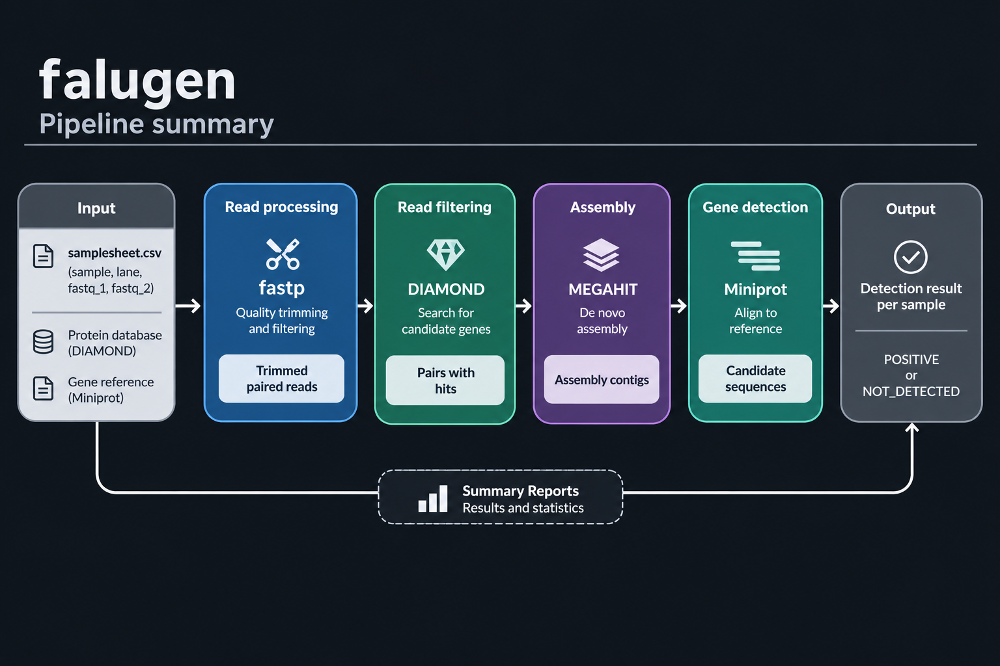

# Falugen

Detect the presence of protein in paired-end short reads.

```
proteins.faa -> DIAMOND_MAKEDB ------------------------------------------+
samplesheet -> CAT_FASTQ (multi-lane only) -> FASTP -> CAT_MATES (R1+R2) -> DIAMOND_BLASTX
  -> GAWK_HIT_IDS -> SEQKIT_GREP (R1, R2) -> MEGAHIT -> GAWK_DECOMPRESS_CONTIGS
  -> MINIPROT_ALIGN (all proteins, one job per sample) -> GAWK_STRIP_COMMENTS
  -> GFFREAD_DNA / GFFREAD_PROTEIN -> GAWK_SPLIT_* (one FASTA per gene) -> detection_summary.tsv
```


## Input

* `--input` samplesheet CSV (`lane` only distinguishes rows; several lanes of one sample are concatenated):

  ```
  sample,lane,fastq_1,fastq_2
  sample1,L001,/path/sample1_R1.fq.gz,/path/sample1_R2.fq.gz
  ```
* `--proteins` **one uncompressed multi-FASTA** with the query proteins. The pipeline builds the DIAMOND
  database from it and uses the same file as the miniprot query. The first word of each header is the gene
  name (it ends up in file names and in the summary; unusual characters are replaced by `_`), so headers must
  be unique. Identical or very similar proteins are allowed.

## Run

The pipeline has been tested on [Dardel HPC](https://www.pdc.kth.se/hpc-services/computing-systems/dardel-hpc-system/dardel-1.1043529). using `-profile pdc_kth` from nf-core/configs.
The pipeline has been tested on [Arrhenius HPC](https://www.naiss.se/resource/arrhenius/). using `-profile naiss` from nf-core/configs.

```
export NXF_SINGULARITY_CACHEDIR=/your_dir/singularity_cache
export APPTAINER_CACHEDIR=/your_dir/apptainer_cache

mkdir test1
cd test1
nextflow run ../falugen/main.nf -profile naiss --project naiss2026-X-XXX --input ../samplesheet.csv --proteins proteins.faa -resume --outdir ris_test1
```

If you get ```sbatch: error: Batch job submission failed: MaxJobCount limit reached``` you can add the parameter ```-c limits.config``` (problem on Dardel).  

If you get ```cat: write error: No space left on device``` you can add the parameter ```-c limits.config``` (problem on Arrhenius). 

## Output (`--outdir`)

| Folder | Content |
|---|---|
| `diamond_db/` | `proteins.dmnd`, the database built from `--proteins` |
| `fastp/` | fastp HTML/JSON/log |
| `diamond/` | DIAMOND hits (`<sample>.txt`) and unique hit read IDs (`<sample>.hit_ids.txt`) |
| `selected_reads/` | R1/R2 reads of the pairs with a hit |
| `assembly/` | MEGAHIT contigs (`<sample>.contigs.fa.gz`) |
| `miniprot/` | miniprot GFF with all proteins (`<sample>.gff`) |
| `sequences/` | one file per sample and detected gene: `<sample>_<gene>_DNA.fasta`, `<sample>_<gene>_protein.fasta`; headers `<sample>_<gene>_<n>` |
| `summary/detection_summary.tsv` | one row per sample and gene (see below) |

`detection_summary.tsv` columns: `sample, gene, status, reason, miniprot_alignments, cds_features`.
`status` is `POSITIVE` (at least one CDS feature aligned from that protein) or `NOT_DETECTED`; `reason` is
`cds_feature_found`, `no_alignment_for_gene`, `no_diamond_hits`, `no_assembled_contigs` or
`no_miniprot_alignment` (the last three apply to every gene of that sample).
`POSITIVE` is not proof of a full-length gene: check identity and coverage in the GFF.